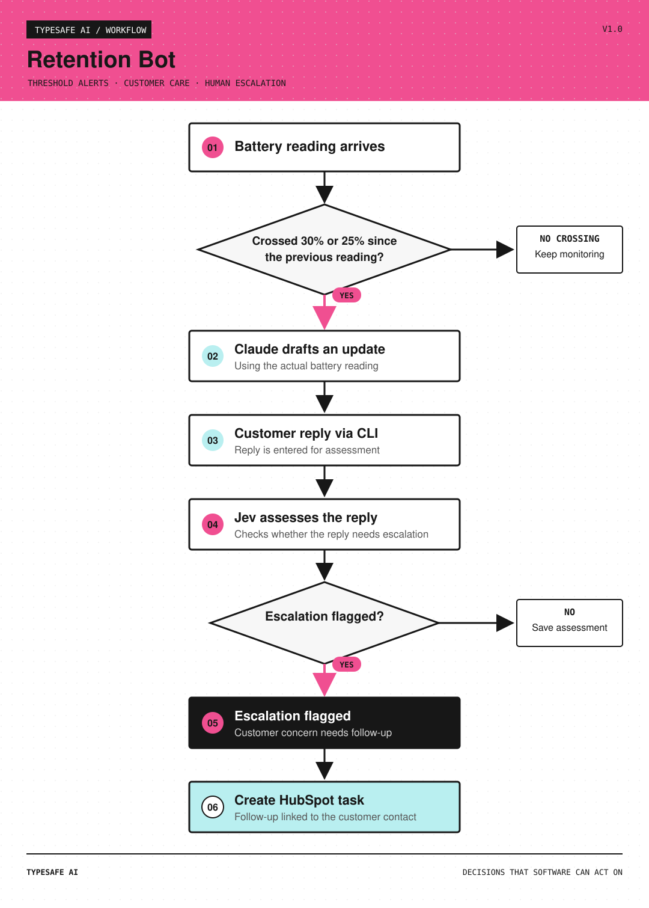

# Customer Retention Bot v1

**Stack/ Systems Involved: Claude, [Jev](https://typesafe.ai/blog/introducing-system-one-models-and-jev), Python, HubSpot**

I built this customer retention bot to help explain these events, flag customer concerns, and keep an engineer in the loop.

The bot, modeled for a battery company, prepares one customer update when charge crosses 30% and another at 25%, per dispatch.

Run `python3 demo.py` to see the sequence offline, or `python3 demo.py --live-claude` with Claude credentials. The first reading establishes a baseline. Skipped readings still count as crossings: 31% to 29% triggers the 30% update using the actual 29% reading. 

Drafts stay in a local review queue. Jev assesses customer replies, and the bot can write escalations to HubSpot as follow-up tasks linked to the customer contact. To write an escalation to HubSpot, set `HUBSPOT_ACCESS_TOKEN` in `.env`. 

When Jev flags the reply, this creates one **Battery customer escalation** task associated with that contact, containing the reply, reasons, and assessment.
